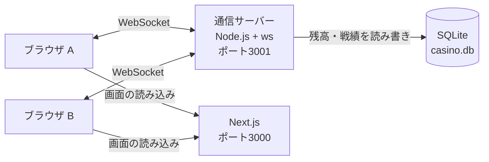

# カジノ風リアルタイムWebアプリ

複数人が同時に、チャット・ポーカー・ブラックジャックを遊べるWebアプリです。
授業「ネットワーククラウド開発」の最終課題として、2人チームで制作しました（2026年6〜7月）。

> 本物のお金は一切使いません。チップは無料で配られ、換金できません。

## つくった理由
お金をかけすぎてしまう友人を見て、お金を使わずにカジノの楽しさだけを味わえる場を作りたいと考えました。

## 担当
**通信部分（`server/`）の設計と実装**を担当しました。
画面（`app/`）はチームメンバーが担当しました。

授業のあと、**データベース（ログイン・チップ残高・戦績の保存）と自動テスト**を追加しました（下の「授業後の改良」）。

## 全体の構成

- 画面（Next.js）は表示だけ。**カードを配る・勝ち負けを決める・チップを動かす処理はすべて通信サーバー**で行います。
- 通信サーバーだけがデータベースを触ります。

## 遊び方ごとに通信の形を作り分けた
| 機能 | 通信の形 | 内容 |
|---|---|---|
| チャット | 1対多 | 1人の発言を、入室している全員に届ける |
| ポーカー | 多対多 | 最大6人が同じ卓に座り、卓の状態をリアルタイムで共有する |
| ブラックジャック | 1対1 | プレイヤーとディーラー（サーバー）の勝負 |

## 工夫したところ
- **ズルができない作り**
  ポーカーの手札は、持ち主にだけ送ります。卓の情報は1人ずつ「その人から見える形」に作り分けて送るため、通信の中身をのぞいても他人の手札は見えません。ブラックジャックのディーラーの伏せ札も、勝負が終わるまで送りません。
- **勝ち負けはサーバーで決める**
  カードを配る・役を判定する・チップを増減する処理はすべてサーバー側で行い、画面側からはごまかせないようにしました。
- **おかしな入力を受け付けない**
  ベット額が数字でない・持っているチップより多い、などの操作ははじいてエラーを返します。名前は16文字、チャットは300文字までに制限しています。
- **途中で抜けても止まらない**
  ブラウザを閉じた人は卓から自動で外し、残った人の画面に参加者とランキングの最新状態を送り直します。

## 授業後の改良：データベースと自動テスト
授業版は「サーバーを止めるとチップが消える」作りだったので、データベースに保存するようにしました。

### できるようになったこと
- 名前とパスワードで**新規登録・ログイン**できる
- **チップ残高が残る**（サーバーを止めても、次にログインしたら続きから）
- ロビーに**戦績**（ゲームごとの回数・勝ち・負け・勝率・合計の増減）と**最近の勝負10件**を表示
- **ランキング**はログインしていない人も含めた全員の上位10人

### テーブル設計
| テーブル | 主な列 | 役割 |
|---|---|---|
| `users` | `id`, `name`（重複禁止）, `password_hash`, `salt`, `chips`（0以上） | アカウントと残高 |
| `games` | `id`, `user_id` → `users.id`, `game_type`, `bet`, `result`, `delta`, `played_at` | 1回ごとの勝負の記録 |

- 戦績は `games` を `GROUP BY` で集計して出します（勝ち数などを別の列に持たないので、数字がずれない）。
- `games.user_id` に索引を付け、「この人の戦績」をすぐ取り出せるようにしています。

### 気をつけたところ
- **パスワードはそのまま保存しない**：ソルト付きのハッシュ（scrypt）にして保存。照合は時間差で推測されにくい比較（`timingSafeEqual`）を使用。
- **ログイン失敗の理由を教えない**：「名前が違う」「パスワードが違う」を区別せず同じメッセージにする。
- **残高と戦績を必ずセットで書く（トランザクション）**：ポーカーでは複数人の残高と記録を一度に書くので、途中で失敗したら全部取り消す。`chips >= 0` の制約で、残高がマイナスになる書き込みもはじく。
- **ズル対策**：同じアカウントで2か所から同時にログインできない。ブラックジャックの途中でブラウザを閉じたら負け扱い（負けそうなときに閉じて逃げられないようにする）。
- **遊べなくならない**：チップが100未満でログインしたら1000に戻す。

### 自動テスト
`npm test` で21個のテストが動きます（Node.js 標準の `node:test` を使用）。
| ファイル | 確かめていること |
|---|---|
| `test/cards.test.js` | ブラックジャックの点数、ポーカーの役判定と強さの比較 |
| `test/db.test.js` | 登録・ログイン・パスワードのハッシュ化・戦績の集計・トランザクションの取り消し |
| `test/server.test.js` | 通信サーバーを実際に起動し、WebSocketでつないでログイン → ゲーム → DBに保存されるまで |

テストは本物の `casino.db` ではなく、メモリ上の一時的なデータベースを使います。

<!-- ここに「苦労したところ」を自分の言葉で書く（例：授業中に詰まったこと、どう解決したか） -->

## 使った技術
- 画面：Next.js（React）
- 通信サーバー：Node.js ＋ ws（WebSocket）
- 言語：JavaScript
- データベース：SQLite（Node.js 標準の `node:sqlite`。追加インストール不要）
- テスト：`node:test`

## ファイル構成
```
├ server/
│  ├ game-server.js … 通信サーバー（ポート3001）。チャット・ポーカー・ブラックジャックの進行
│  ├ db.js          … データベース（登録・ログイン・残高・戦績）
│  └ cards.js       … トランプの山札づくり・シャッフル・役の判定
├ test/             … 自動テスト
├ app/
│  ├ page.js        … 画面（ロビー・ポーカー・ブラックジャック・チャット）
│  ├ layout.js
│  └ globals.css    … カジノ風のデザイン
└ package.json
```

## 動かし方
Node.js 22.13 以上が必要です。
```
npm install
npm run dev
```
ブラウザで `http://localhost:3000` を開き、名前とパスワードを入れて「はじめて登録する」を押します（2回目からは「ログイン」）。
別のタブでもう1つ開いて別の名前で登録すると、2人目として遊べます（ポーカーは2人以上で開始できます）。
データは `casino.db` に保存されます。消すと最初からやり直しになります。

テストの実行：
```
npm test
```

## これからやりたいこと
- インターネット上に公開し、離れた場所の人とも遊べるようにする
- ルーレットやスロットを追加する
- 人数が増えたときに備えて、データベースを PostgreSQL に移す
